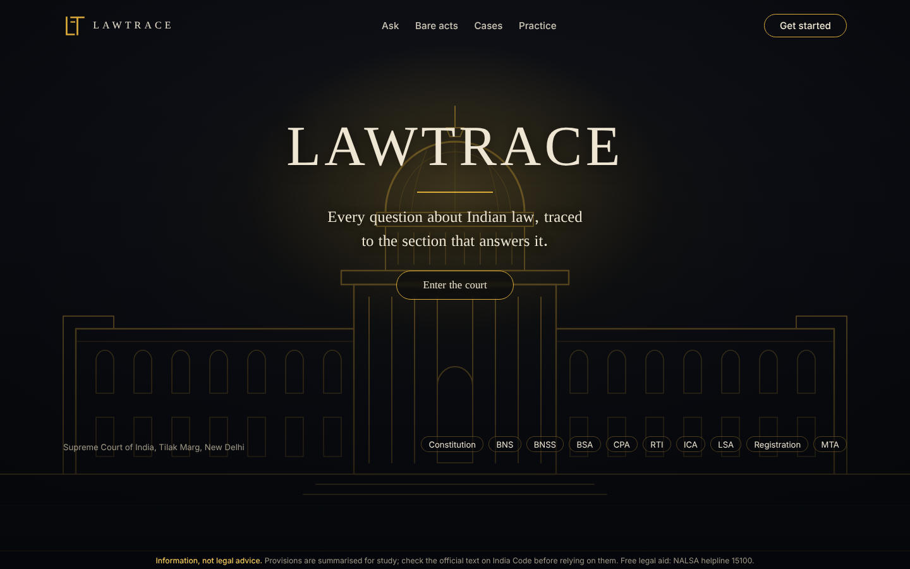
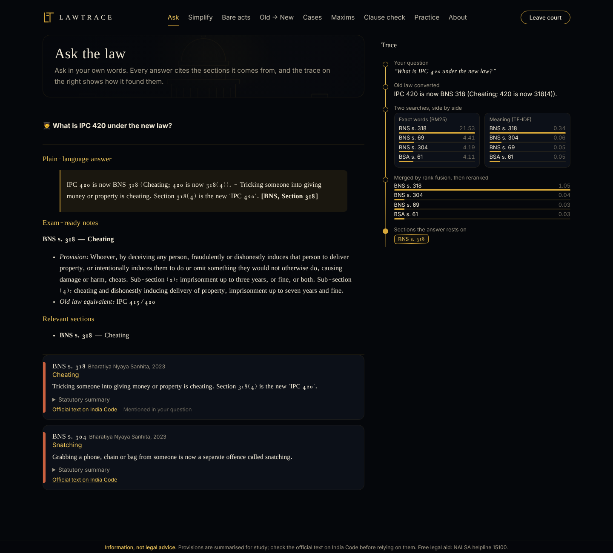

# LAWTRACE

**One place for Indian law students.** Ask any legal question in English or Hindi and get an answer traced to the exact section it comes from, with a live view of how the search found it.



## What's inside

| Page | What it does |
|---|---|
| **Ask** | Retrieval-augmented Q&A over the Constitution, BNS, BNSS, BSA, Consumer Protection Act, RTI Act, Contract Act and more. Every answer cites `[Act, Section]`; a **Trace** panel shows the question's path through keyword search, meaning search, rank fusion and reranking. Exam-ready mode adds old-law equivalents and cases to cite. |
| **Simplify** | Paste a clause: jargon is underlined with hover meanings, long sentences are split at every proviso, deadlines and amounts are pulled out. Optional AI rewrite. |
| **Bare acts** | Browse every provision with a plain-language note, plus a section of the day. |
| **Old → New** | IPC / CrPC / Evidence Act → BNS / BNSS / BSA converter, both directions. |
| **Cases** | Timeline of 22 landmark judgments: facts, holding, why it matters. |
| **Maxims** | Latin maxims as flashcards, plus a ~90-term glossary. |
| **Clause check** | Upload a rent agreement or contract (PDF/TXT). Risky clauses are flagged with the law behind each concern and a fairness score; download a report. |
| **Practice** | Auto-generated quizzes on conversions, cases, maxims and provisions. |
| **About** | Architecture and live evaluation numbers. |



## How it works

```
Bare acts (PDF) → section-aware chunker → BM25 index + meaning index (TF-IDF, or bge-m3)
Question (EN / HI / Hinglish) → language bridge → old-law & Article reference resolver
  → hybrid search → Reciprocal Rank Fusion → rerank → confidence gate (refuses when nothing matches)
  → answer (Gemini / Ollama / offline extract) → citation verifier
```

- **Grounded:** the model only sees retrieved sections; citations not in that set are flagged.
- **Works without any API key:** offline mode composes answers from the matched sections.
- **Light enough for the free Streamlit Cloud tier.** Heavier dense embeddings and a cross-encoder are one setting away.

## Evaluation

`python -m evaluation.run_eval` (56 hand-written questions, including Hindi, Hinglish and old-law references, plus off-topic questions that must be refused):

| Metric | Value |
|---|---|
| Hit@1 | 92.2% |
| Hit@5 | 98.0% |
| MRR | 0.944 |
| Correct refusals (off-topic) | 100% |

The keyword lists were refined while building this set, so treat these as development-set numbers. Add fresh questions to `evaluation/eval_set.json` for a fair held-out score. `--ragas` adds RAGAS faithfulness and answer relevancy when an LLM key is set.

## Run locally

```bash
python -m venv .venv && source .venv/bin/activate     # Windows: .venv\Scripts\activate
pip install -r requirements-dev.txt
streamlit run app.py
pytest
```

Optional: copy `.streamlit/secrets.toml.example` to `.streamlit/secrets.toml` and add a free Gemini key from [Google AI Studio](https://aistudio.google.com/) for fuller answers and Hindi replies.

## Deploy on Streamlit Community Cloud (free)

1. Push this folder to a GitHub repo named `LAWTRACE`.
2. Go to [share.streamlit.io](https://share.streamlit.io), sign in with GitHub, click **Create app**, pick the repo, branch `main`, main file `app.py`.
3. Optional: under **Advanced settings → Secrets**, paste `GEMINI_API_KEY = "..."`.
4. Deploy. Your app gets a `*.streamlit.app` link.

## Add the full text of more acts

Download bare-act PDFs from [India Code](https://www.indiacode.nic.in/) into `data/raw/`, named like `Bharatiya Nyaya Sanhita__2023.pdf`, then:

```bash
python -m lawtrace.ingestion.chunker --input data/raw --output data/processed/chunks.jsonl
```

Restart the app; the new sections are searched and cited automatically.

## Project layout

```
app.py                     Streamlit app (gate + 9 pages)
lawtrace/data/             acts, sections, conversions, cases, maxims, glossary (JSON)
lawtrace/retrieval/        BM25, meaning search, hybrid fusion + rerank
lawtrace/generation/       prompts, LLM switch (Gemini / Ollama / offline), answer + citation check
lawtrace/tools/            simplifier, clause scanner, converter + quiz
lawtrace/ingestion/        PDF parser and section-aware chunker
lawtrace/ui/               theme (CSS) and HTML components
evaluation/                eval set and metrics
tests/                     unit tests and page smoke tests
```

## Disclaimer

LAWTRACE gives information, not legal advice. Built-in provisions are study summaries, not the official wording; laws and their enforcement change. Check the official text on India Code, and for help with a real situation contact a lawyer or free legal aid (NALSA helpline 15100).
